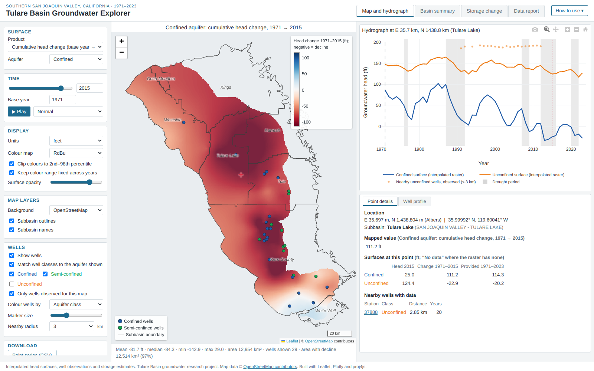

# Tulare Basin Groundwater Explorer (web version)

An interactive website for exploring groundwater in the southern San Joaquin Valley
(Tulare Basin), California, 1971–2023. It shows confined and unconfined aquifer head
maps, head change, hydrographs at any point, observed wells with their construction,
basin statistics and regional storage change. It runs entirely in the visitor's
browser, so it can be hosted **free on GitHub Pages**: no server, no sleeping, nothing
to install.

It is a web conversion of the **desktop Tulare Basin Groundwater Head Explorer,
version 3**. Its numbers were checked against that desktop code (see
`VALIDATION_AND_PERFORMANCE.md`).



---

## What is in this folder

```
tulare-groundwater-web/
├── docs/                    ← THE WEBSITE (GitHub Pages publishes this folder)
│   ├── index.html
│   ├── css/app.css
│   ├── js/core.js           calculations (decoding, cells, statistics)
│   ├── js/app.js            the interface
│   ├── vendor/              Leaflet, Plotly, proj4js (bundled, no CDN needed)
│   └── data/                pre-built data (≈38 MB, 295 files, all < 1.1 MB)
├── build/                   rebuilds docs/data from your original project files
│   ├── build_web_data.py
│   ├── tulare_explorer/     the desktop v3 science code, unchanged
│   └── requirements.txt
├── validation/              tests that compare the website with the desktop code
├── screenshots/             pictures of the real website
├── run_local.bat            double-click to test the website on Windows
├── README.md                this file
├── FEATURES.md              what was kept, changed or left out, and why
└── VALIDATION_AND_PERFORMANCE.md   what was tested, results, speed, limitations
```

You do **not** need your original 250 MB data folder to publish the website:
everything the site needs is already in `docs/data/`.

---

## 1. Test it on your computer (Windows)

A website cannot be opened by double-clicking `index.html` (browsers block it from
reading its data files). Use a tiny local web server instead:

**Easiest:** double-click **`run_local.bat`**. A black window opens and your browser
shows the site at `http://localhost:8000`. Keep the black window open while you use
the site; close it when you are done.

**If that does not work** (Python not found), open the **Anaconda Prompt** and type:

```
cd /d "C:\path\to\tulare-groundwater-web\docs"
python -m http.server 8000
```

then open **http://localhost:8000** in Chrome, Edge or Firefox.

---

## 2. Put it on GitHub with GitHub Desktop

1. Unzip this project somewhere simple, for example `Documents\tulare-groundwater-web`.
2. Open **GitHub Desktop** → **File → Add local repository…** → choose the
   `tulare-groundwater-web` folder → **Add repository**.
   If it says *"This directory does not appear to be a Git repository"*, click
   **create a repository** → keep the name → **Create repository**.
3. In the left panel you will see all the files. At the bottom left type a summary,
   for example *Initial version of the web app*, and click **Commit to main**.
4. Click **Publish repository** (top bar).
   **Untick "Keep this code private"**: free GitHub Pages needs a public
   repository. Click **Publish repository**.

Uploading takes a few minutes (about 40 MB).

---

## 3. Make it a public website (GitHub Pages, free)

1. Open your repository on **github.com** (GitHub Desktop: **Repository → View on
   GitHub**).
2. Click **Settings** → **Pages** (left menu).
3. Under **Build and deployment**, set **Source: Deploy from a branch**, then
   **Branch: `main`** and folder **`/docs`** → **Save**.
4. Wait 1–3 minutes and refresh the page. GitHub shows the address, which looks like:

   **`https://YOUR-USERNAME.github.io/tulare-groundwater-web/`**

That link works for anyone, on any computer, with nothing to install.

**To update the site later:** change files, then in GitHub Desktop **Commit to main**
→ **Push origin**. The website updates by itself within a few minutes.

### GitHub Pages limits

These are from my knowledge, not checked live; confirm on GitHub's page
*"GitHub Pages limits"*: https://docs.github.com/en/pages/getting-started-with-github-pages/github-pages-limits

| Limit (as I know it) | This website |
|---|---|
| Published site up to about 1 GB | about 40 MB ✅ |
| Files over 100 MB are refused (warning at 50 MB) | largest file 1.07 MB ✅ |
| Soft bandwidth limit about 100 GB per month | about 1.6 MB per first visit, so tens of thousands of visits per month ✅ |
| Free for public repositories | ✅ |

### OpenStreetMap background

The map background comes from the OpenStreetMap tile servers, which are free under
their tile usage policy (https://operations.osmfoundation.org/policies/tiles/). A
research website with ordinary traffic is normally fine. If you ever expect very heavy
traffic, choose **Background → None** as the default or switch to another tile
provider. The groundwater data never depend on the background.

---

## 4. Update the data (only if your rasters or wells change)

The website's data were built from your project folder with the same science code as
the desktop app. To rebuild after changing the original data:

```
conda activate <your environment with rasterio and geopandas>
cd tulare-groundwater-web
python build/build_web_data.py --src "C:\path\to\analysis\total_wells"
```

This replaces `docs/data/` (about 20 seconds). Then commit and push with GitHub
Desktop.

---

## Using the website (also in its "How to use" panel)

- **Map and hydrograph:**
  - Choose a product (absolute head, cumulative change from a base year, or the
    provided 1971–2023 change), an aquifer, and a year.
  - Click the map for a hydrograph. **Lines** are the interpolated surfaces at that
    500 m cell; **dots** are **observed** wells nearby.
  - Click a well marker for its record and **well profile**.
- **Basin summary:** eight panels (Mean, Q1, Median, Q3) for head and change since
  1971, with confined (solid blue) and unconfined (dashed orange) together, for the
  whole area or one subbasin.
- **Storage change:** regional storage change since 2015 from the storage workbook:
  cards, time series, components for any year, and a table.
- **Data report:** every file, unit check and assumption.
- **Downloads:**
  - point series (CSV);
  - map image (PNG);
  - map values on the original 500 m grid (ESRI ASCII grid + `.prj`, opens in
    QGIS/ArcGIS);
  - basin statistics (CSV);
  - storage table (CSV);
  - every chart as PNG, using the camera icon.

Works in current Chrome, Edge, Firefox and Safari on laptops and desktops.

---

## Credits and licences

- **Data and analysis:** Tulare Basin groundwater research project.
- **Map background:** © OpenStreetMap contributors.
- **Bundled libraries:** Leaflet (BSD-2), Plotly.js (MIT) and proj4js (MIT). Their
  licences are in `docs/vendor/`.
- **Choose a licence for your own code and data** (for example MIT for code, CC-BY
  for data) with your advisor before making the repository public.
